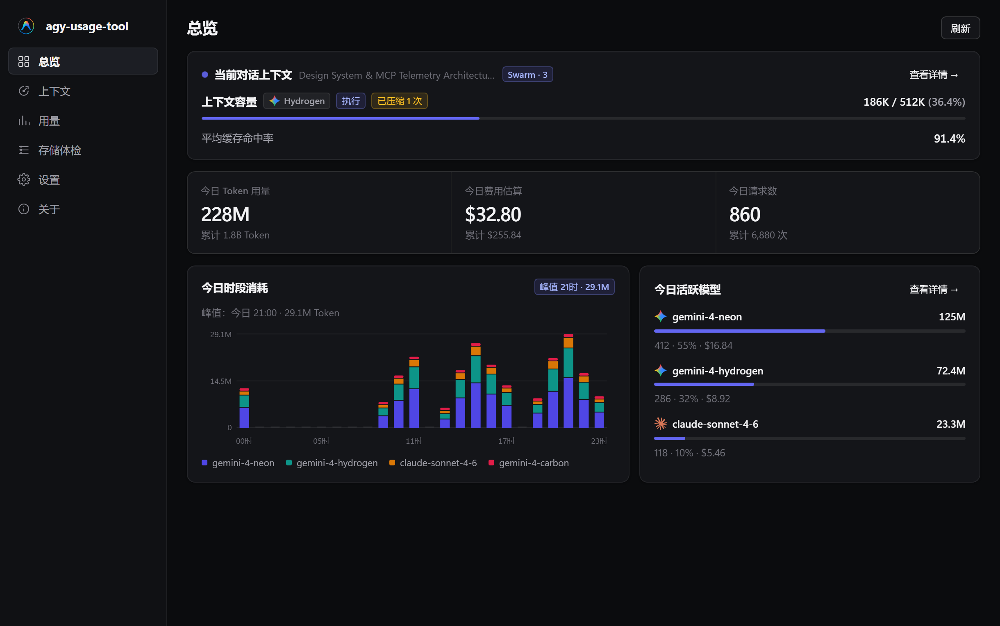
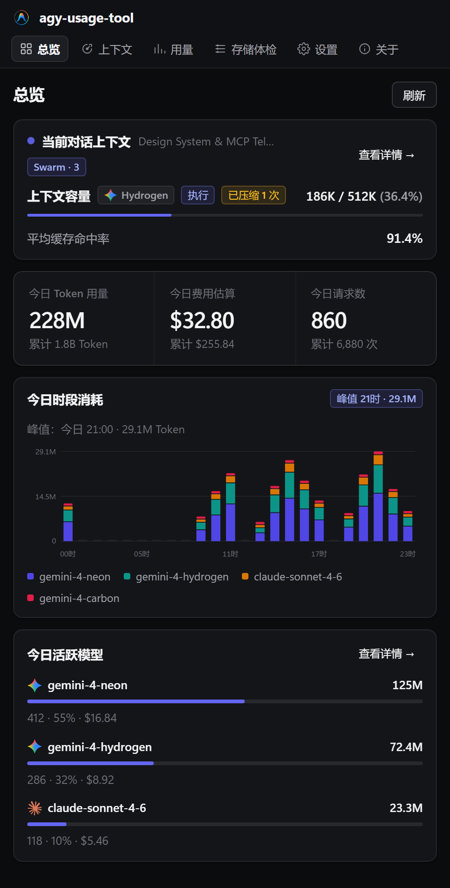
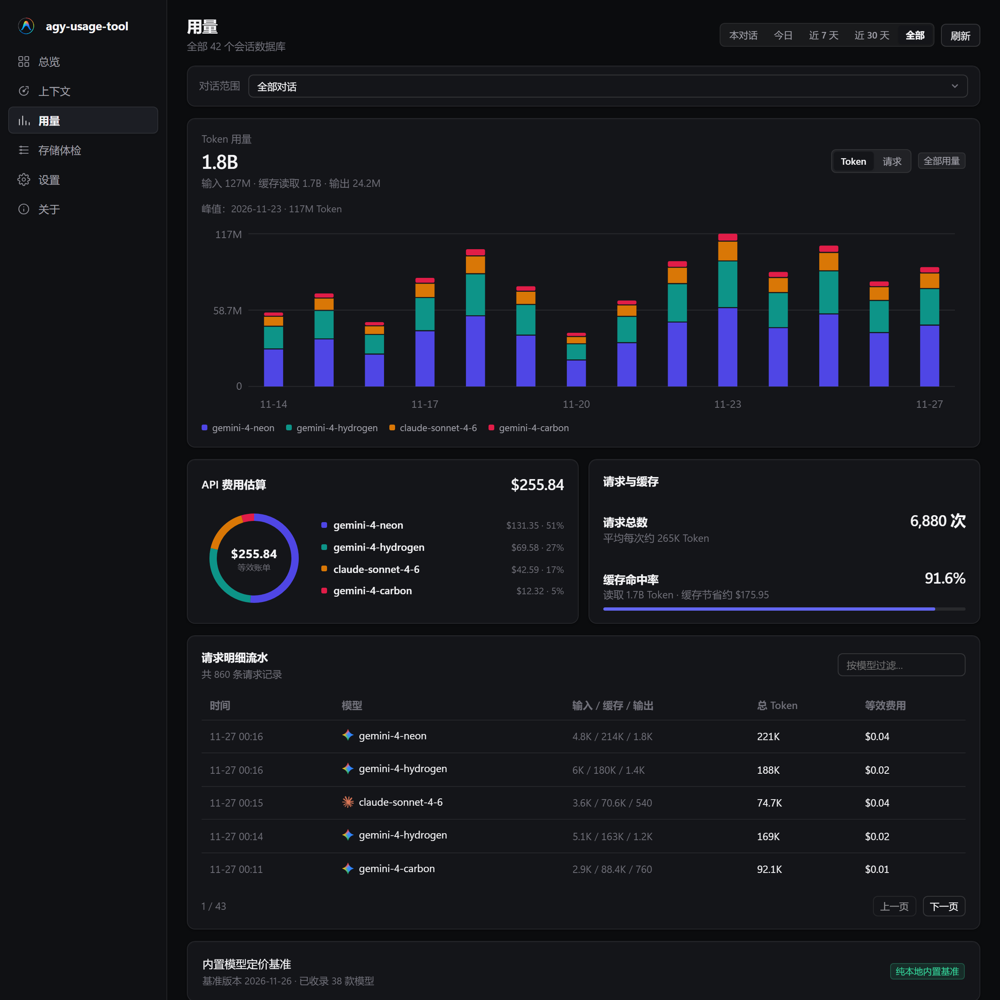
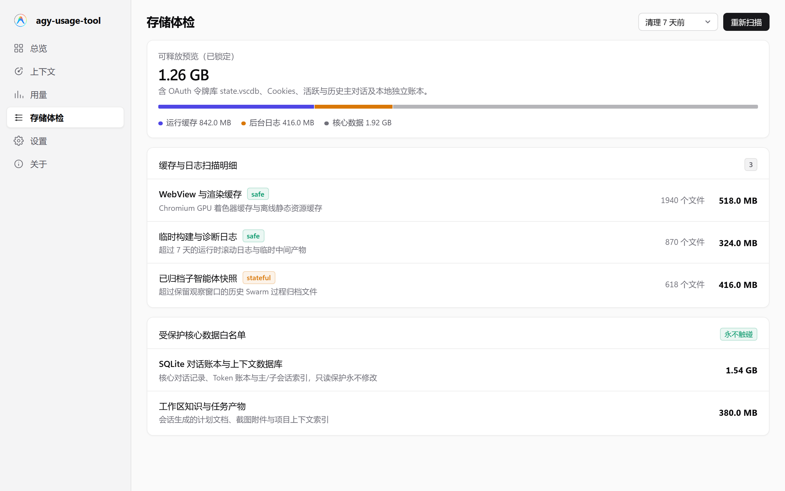

<div align="center">
  
  <h1>agy-usage-tool</h1>
  <p><strong>Antigravity 本地用量分析、双阶段上下文水位与存储体检 MCP App</strong></p>
  <p>纯本地读取 SQLite 对话账本 —— 今天消耗多少 Token、当前上下文剩余几何、Orchestrator 规划/执行与 Swarm 子智能体各自跑到哪一步，一目了然。</p>
  <p></p>
  <p>
    <a href="#界面一览">界面一览</a> ·
    <a href="#多视图详解">多视图详解</a> ·
    <a href="#核心能力">核心能力</a> ·
    <a href="#快速安装">快速安装</a> ·
    <a href="#v011-更新说明">v0.1.1 更新</a> ·
    <a href="https://github.com/laishaojue-commits/agy-usage-tool/releases">Releases</a>
  </p>
</div>

---

## 界面一览

> 支持**浅色（Studio Zinc）/ 深色（Obsidian）**双主题自动跟随或手动切换，桌面主视图与 Antigravity 辅助侧栏（`< 720px`）均保持统一的三列细分割线 KPI 账本条与利落层级。

<a href="./assets/screenshots/overview.png">
  
</a>

<table>
  <tr>
    <th width="68%">深色主题（Obsidian）主视图</th>
    <th width="32%">Antigravity 窄侧栏自适应</th>
  </tr>
  <tr>
    <td width="68%" valign="top">
      <a href="./assets/screenshots/overview-dark.png">
        
      </a>
      <p>自动锁定当前宿主对话水位，不随「上下文」标签页的切表浏览而串台；24 小时分模型堆叠柱支持悬停读取精确时段指标。</p>
    </td>
    <td width="32%" valign="top">
      <a href="./assets/screenshots/sidepane-dark.png">
        
      </a>
      <p>在 480px 窄侧栏内自动折叠为吸顶导航，三列核心指标仍紧凑并排展示，去掉一切冗余只读占位条。</p>
    </td>
  </tr>
</table>

---

## 多视图详解

### 1. 上下文监控 · Orchestrator 双阶段 & Swarm 独立水位

<a href="./assets/screenshots/context.png">
  
</a>

- **对话面板自动固定本对话**：在对话窗打开时停留在当前会话（右上角显示`已固定本对话`），不会因后台其他窗口活跃而突然跳走；需要排查历史会话时可随时通过下拉框切换，并一键**切至最新活跃**。
- **Orchestrator 规划 / 执行阶段拆解**：按升序折叠多条 `executor_metadata` 并跟踪 `exit_plan_mode` / `enter_plan_mode` 状态转换，准确分离规划模型与执行模型的独立上下文容量、压缩次数与激活状态，消除幽灵 `—` 占位行。
- **Swarm 子智能体独立水位与协作汇总**：按成员各自模型上限（含 `参考模型上限` 提示）独立计算占比，点击任意成员行即可展开缓存复用、新增输入、历史峰值与步数/估算费用详情，底部聚合整场协作总消耗。

### 2. 用量分析 · 「本对话」锁定与全周期多模型趋势

<table>
  <tr>
    <th width="50%">今日维度（浅色）· 24h 分模型趋势与明细流水</th>
    <th width="50%">全部周期（深色）· 多日分布与按对话范围下钻</th>
  </tr>
  <tr>
    <td width="50%" valign="top">
      <a href="./assets/screenshots/usage.png">
        
      </a>
      <p>支持 <code>Token</code> / <code>请求数</code> 一键切换视图维度、等宽数字对齐的费用环形图，以及支持按模型实时搜索与分页的请求明细流水。</p>
    </td>
    <td width="50%" valign="top">
      <a href="./assets/screenshots/usage-all-dark.png">
        
      </a>
      <p>在<strong>全部</strong>周期内提供独立的<code>对话范围</code>下拉筛选器，默认展示<code>全部对话</code>，也可按单场对话（含其 Swarm 家族）独立统计而不干扰其他页面。</p>
    </td>
  </tr>
</table>

- **五大统计窗口职责清晰**：
  - **本对话**：始终锁定当前所在对话（主对话 + 所有关联 Swarm 子智能体 `.db`），单日内展示 24 小时趋势、跨天展示活跃日趋势。
  - **今日 / 近 7 天 / 近 30 天**：聚焦全工作区时间窗口趋势，无多余干扰控件。
  - **全部**：兼顾全量历史统计与**按对话范围筛选**下钻复盘。

### 3. 存储体检 · 纯本地只读缓存巡检与核心白名单

<a href="./assets/screenshots/storage.png">
  
</a>

- **零写入安全体检**：支持按 `7 天 / 30 天 / 全部` 观察窗口扫描 WebView 着色器缓存、临时日志与历史归档占比，同时在受保护白名单中明确标注绝不触碰的 SQLite 对话账本与知识索引目录；高风险清理与切号操作均在后端只读门禁直接锁定拦截。

---

## 核心能力

| 面板视图 | 核心能力说明 |
| :--- | :--- |
| **总览** | 固定跟踪当前对话上下文紧凑卡片、今日/累计 Token 与等效估算费用、请求数、24 小时分模型堆叠图、今日活跃模型 TOP 排行 |
| **上下文** | 主对话上下文容量与缓存命中率、Orchestrator 规划/执行双阶段独立水位、Swarm 成员可展开详情与整场协作总消耗汇总 |
| **用量** | **本对话 / 今日 / 近 7 天 / 近 30 天 / 全部** 五档周期切换、Token/请求维度切换、费用环形图、搜索分页请求流水与内置模型费率版本 |
| **存储体检** | 纯本地只读扫描运行缓存、历史子智能体归档与受保护核心目录大小分布（严禁任何删除或修改外部文件操作） |
| **安全边界** | 零外网请求、零 OAuth 凭据读取、零进程/调试端口探测，仅在插件独立数据目录保存外观主题；详情见 [SECURITY.md](./SECURITY.md) |

> **说明**：面板中的金额基于内置公开 API 费率做本地等效估算，仅供参考而非实际账单。

---

## 快速安装

> 运行环境要求：**Antigravity** 与 **Node.js ≥ 22.15.0**（终端运行 `node -v` 可正常输出版本号；无论 ZIP 还是源码安装均依赖本机 Node.js）。

### 方式一：下载 Release 压缩包

1. 前往 [Releases](https://github.com/laishaojue-commits/agy-usage-tool/releases) 下载 **`agy-usage-tool-v0.1.1.zip`**。
2. 解压至当前系统的 Antigravity 插件目录，确认打开该目录第一层即可看到 **`plugin.json`**：

   | 操作系统 | 插件目标目录 |
   | :--- | :--- |
   | **Windows** | `%USERPROFILE%\.gemini\config\plugins\agy-usage-tool\` |
   | **macOS / Linux** | `~/.gemini/config/plugins/agy-usage-tool/` |

3. 打开 Antigravity 插件管理页启用 **agy-usage-tool**，即可从左侧主导航或辅助侧栏 **`+`** 菜单打开面板。

<details>
<summary><strong>方式二：从源码构建并安装到本机</strong></summary>

```sh
git clone https://github.com/laishaojue-commits/agy-usage-tool.git
cd agy-usage-tool
npm ci --ignore-scripts
npm --prefix ui ci --ignore-scripts
npm --prefix plugin ci --omit=dev --ignore-scripts
npm run plugin:install
```

同一暂存目录下请勿并发执行多个安装命令；源码安装脚本在检测到 Windows 下运行中的 MCP 进程占用目录重命名（`EBUSY`）时，会自动走安全原地同步热更新回退。

</details>

<details>
<summary><strong>手动升级与目录占用提示</strong></summary>

1. 使用压缩包手动覆盖旧版前，建议先在 Antigravity 插件管理页停用旧插件，让运行中的 `node` MCP 进程释放目录锁。
2. 请将旧插件目录移出备份后再解压放入新版，避免旧版构建残留在 `backend/dist/`。
3. 主题外观偏好独立存储在插件数据目录（`ui-prefs.json`），替换程序目录不会影响已选主题。

</details>

---

## v0.1.1 更新说明

- **高密度精密 UI 与浅/深双主题重塑**：在 `v0.1.0` 完成 `agy-usage-tool` 更名与 Orchestrator 双阶段识别基础上，全面重构 Studio Zinc（浅色）与 Obsidian（深色）视觉体系，引入高对比度黑白主按钮、细分割线三联 KPI 条、窄侧栏吸顶导航、等宽数据对齐与 `4px` 细精度进度轨，并移除总览/存储/侧栏多余只读横幅与占位状态条。
- **总览 / 上下文状态解耦与「本对话」用量追踪**：
  - 修复在「上下文」切换历史会话时联动覆盖「总览」上下文卡片的问题；对话窗场景下上下文自动固定在当前对话；
  - 「用量」页新增**本对话**周期维度（聚合主对话及关联 Swarm 子智能体家族 Token、费用、趋势图与流水），同时将历史**对话范围**筛选器收敛进**全部**标签页独立运作。
- **Windows 运行期安装加固与文档焕新**：为 `npm run plugin:install` 补充 Windows `EBUSY`/`EPERM` 原地安全热更新回退，并补充 7 张 2x Retina 浅深色与窄侧栏高清截图展示。
- **v0.1.0 基础能力延续**：升序折叠 `executor_metadata`、跟踪 `exit_plan_mode` / `enter_plan_mode` 状态转换与 `modelEnum` 自学习映射，保留纯简体中文轻量化包体与 L0 纯本地只读门禁。

---

## 本地开发与许可

<details>
<summary><strong>构建、测试、打包与隐私门禁命令</strong></summary>

```sh
npm ci --ignore-scripts
npm --prefix ui ci --ignore-scripts
npm --prefix plugin ci --omit=dev --ignore-scripts
npm test
npm run plugin:zip -- --rebuild
npm run check:privacy -- --include-build
```

打包产物与校验摘要输出在 `artifacts/`（含 `agy-usage-tool-v0.1.1.zip` 与 `SHA256SUMS.txt`），同时强制校验 34 个后端模块 AST 白名单与零隐私/本地路径泄露规则。

</details>

本项目基于 [MIT License](./LICENSE)（Copyright © 2026 Enzoo404）开源。致谢上游项目 [Enzoo404/gravitybox](https://github.com/Enzoo404/gravitybox)（`v1.1.3`）提供的本地 SQLite 用量分析、上下文统计与定价核心模块，第三方署名与免责说明见 [THIRD_PARTY_NOTICES.md](./THIRD_PARTY_NOTICES.md)。
