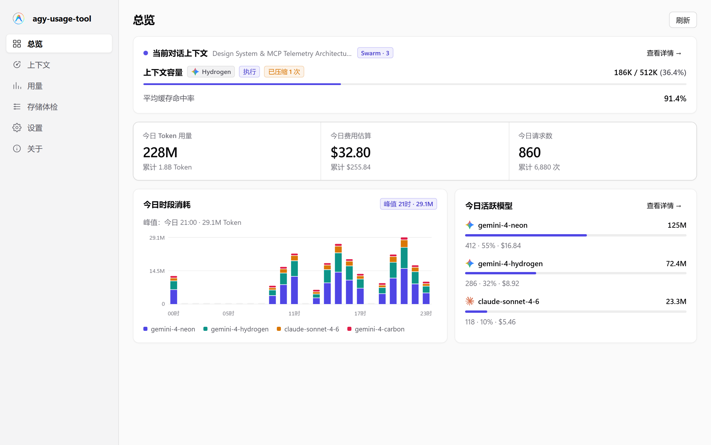
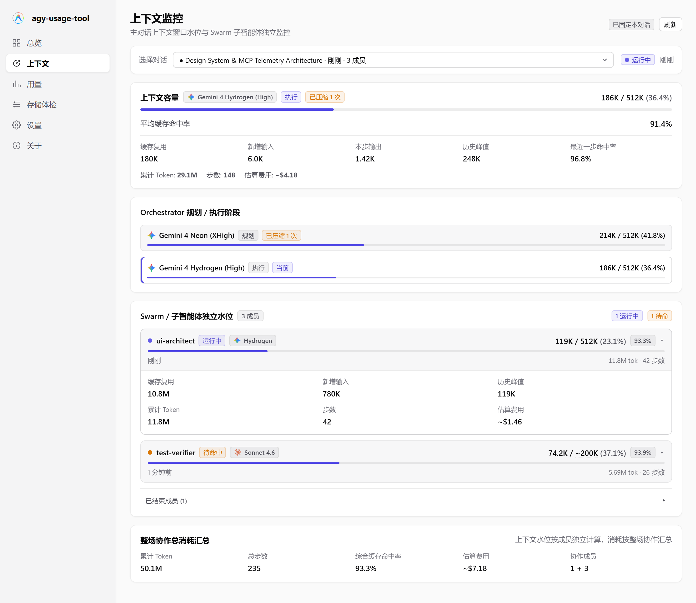
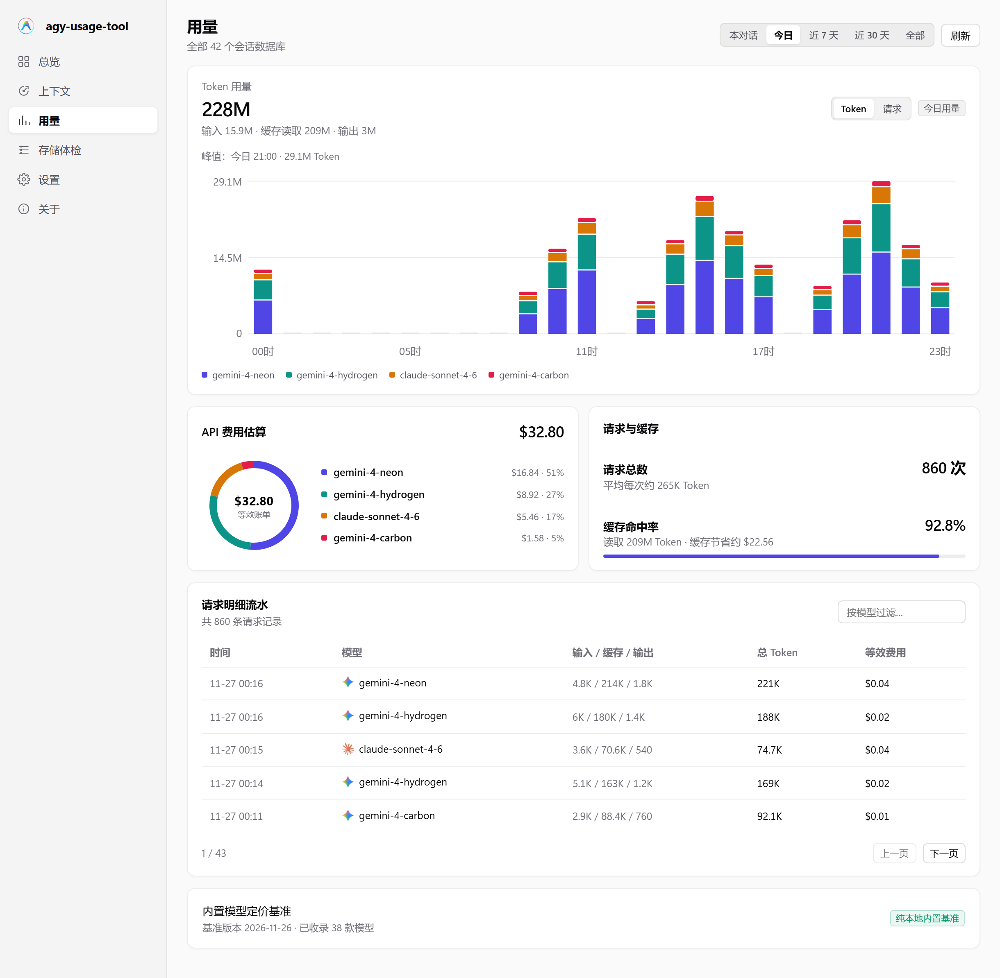

<div align="center">
  
  <h1>agy-usage-tool</h1>
  <p><strong>Antigravity 的本地用量面板</strong></p>
  <p>今天用了多少 Token？哪个模型用得最多？这场对话的上下文还剩多少？</p>
  
  <p>
    <a href="#快速安装"><strong>快速安装</strong></a> ·
    <a href="https://github.com/laishaojue-commits/agy-usage-tool/releases">发布页</a> ·
    <a href="#界面预览">界面预览</a> ·
    <a href="./README_EN.md">English</a>
  </p>
</div>

## 界面预览

<a href="./assets/screenshots/overview.png"></a>

<table>
  <tr>
    <th width="50%">上下文还剩多少？</th>
    <th width="50%">Token 都花在哪儿？</th>
  </tr>
  <tr>
    <td width="50%" valign="top">
      <a href="./assets/screenshots/context.png"></a>
      <p>查看主对话和子智能体各自用了多少上下文、压缩过几次。</p>
    </td>
    <td width="50%" valign="top">
      <a href="./assets/screenshots/usage.png"></a>
      <p>按时间和模型看 Token、请求次数、缓存命中率和费用估算。</p>
    </td>
  </tr>
</table>

## 快速安装

**准备好 Antigravity 和 Node.js ≥ 22.15.0**，在终端运行 `node -v` 能看到版本号即可。ZIP 和源码安装都需要 Node.js。

1. 从 [Releases](https://github.com/laishaojue-commits/agy-usage-tool/releases) 下载 `agy-usage-v0.0.0.zip`。如果发布页还没有 ZIP，可以展开下方的源码安装。
2. 解压到下面的插件目录，确保打开该目录就能看到 `plugin.json`。

   | 系统 | 插件目录 |
   | --- | --- |
   | Windows | `%USERPROFILE%\.gemini\config\plugins\agy-usage\` |
   | macOS / Linux | `~/.gemini/config/plugins/agy-usage/` |

3. 在 Antigravity 的插件管理页启用 **agy-usage**。启用后，在左侧栏打开 **agy-usage**，也可以通过辅助侧栏的 **+** 菜单添加。

<details>
<summary><strong>从源码安装</strong></summary>

```sh
git clone https://github.com/laishaojue-commits/agy-usage-tool.git
cd agy-usage-tool
npm ci --ignore-scripts
npm run plugin:install
```

安装后按上面的方式启用插件。同一插件暂存目录下，请一次只运行一个安装命令。

</details>

<details>
<summary><strong>已安装？查看升级与 Windows 文件锁处理</strong></summary>

1. 停用插件，把旧的整个 `plugins/agy-usage` 目录移到插件目录之外备份。
2. 把新版解压到干净的 `plugins/agy-usage` 目录，再重新启用。不要覆盖解压，否则旧文件会留在磁盘上。
3. Windows 如果仍报目录被占用，完全退出 Antigravity，替换完成后再打开。

界面偏好保存在独立的插件数据目录，不需要随程序目录一起移动。

</details>

## 面板里还能看什么

- **用量明细**：按今天、近 7 天、近 30 天或全部切换，搜索单次请求，看看各模型用了多少。
- **协作用量**：区分规划和执行阶段，分开看子智能体的上下文，用量则可以看整场协作的合计。
- **存储体检**：看看缓存和日志占了多少空间，只展示，不替你清理文件。

> 统计在本机完成，不读取账号凭据，也不上报用量。截图中的金额是参考价格换算，不是实际账单。实现细节见 [SECURITY.md](./SECURITY.md)。

## 开发与许可

<details>
<summary><strong>构建、测试和打包</strong></summary>

```sh
npm ci --ignore-scripts
npm --prefix ui ci --ignore-scripts
npm --prefix plugin ci --omit=dev --ignore-scripts
npm test
npm run plugin:zip -- --rebuild
npm run check:privacy -- --include-build
```

ZIP 和校验文件生成在 `artifacts/`。

</details>

[MIT 许可](./LICENSE)（Copyright © 2026 Enzoo404）。感谢上游 [Enzoo404/gravitybox](https://github.com/Enzoo404/gravitybox)（`v1.1.3`）提供本地用量、上下文与定价模块。详见 [THIRD_PARTY_NOTICES.md](./THIRD_PARTY_NOTICES.md)。
