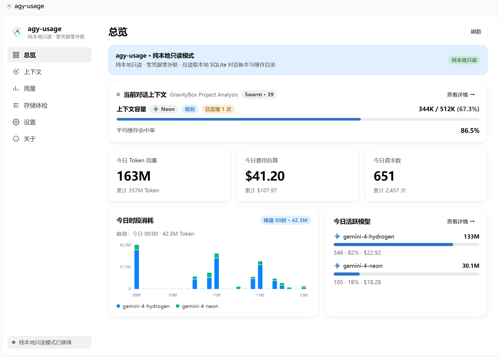
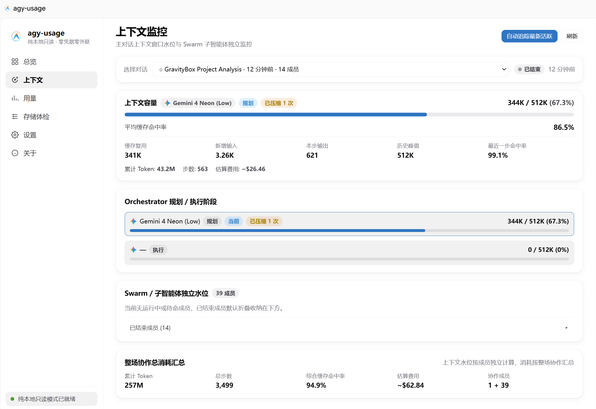
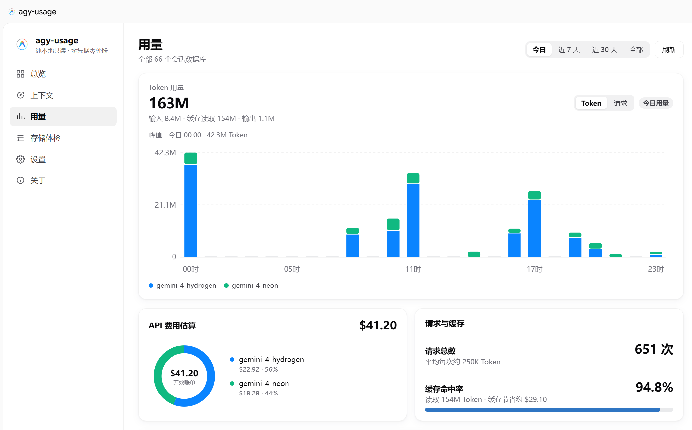

# agy-usage

**agy-usage 是一个帮你查看 Antigravity 用量的插件。** 打开面板就能看到今天用了多少 Token、哪个模型用得最多，以及当前对话还剩多少上下文空间。你也可以查看各个子智能体的上下文占用，看看本地缓存占了多少空间。统计都在本机完成，费用是估算，不是实际账单。

[English Documentation](./README.md)

## 界面预览







## 核心功能

- **总览面板 (Overview)**：今日与累计 Token、等效费用估算、请求次数、当前活跃对话上下文摘要卡片、24 小时按模型堆积柱状图及热门模型占比。
- **上下文窗口与 Swarm 监控 (Context)**：
  - 实时展示主对话上下文占用与容量上限（`已用 / 容量`），区分底层数据库显式阈值与模型参考阈值，并统计自动压缩次数。
  - 支持 Orchestrator 规划 / 执行阶段及多模型切换水位展示。
  - 独立追踪每个 Swarm 子智能体的运行状态（运行中 / 待命 / 默认折叠的已结束成员）与整场协作总消耗汇总。
- **用量与费用分析 (Usage)**：
  - 支持 `今日` / `7 天` / `30 天` / `全部` 周期切换，以及 `Token` / `请求次数` 双模式堆积柱状图（悬停显示时间、模型与精确数值）。
  - 堆积柱状图与 API 费用估算环形图共享统一确定性模型色板。
  - 支持请求流水明细搜索过滤、分页浏览与纯本地内置模型定价基准展示。
- **只读存储体检 (Storage)**：
  - 安全测算可清理缓存、历史日志与受保护核心目录（`conversations`、`knowledge`、`brain` 等）占用；所有破坏性清理与切号操作均被后端只读门禁锁拦截（`READ_ONLY_UNSUPPORTED`）。

## 架构与 L0 安全边界

`agy-usage` 严格运行在 **L0 纯本地只读模式**：

- **34 模块后端白名单**：`tools/plugin-allowlist.mjs` 通过 TypeScript AST 静态审计严格限定仅允许 34 个纯本地模块，禁止 `fetch()`、`require()`、`eval()` 与动态导入。
- **零进程探测与零凭据**：不启动 PowerShell / Win32 / POSIX 进程扫描，不读取 OAuth 凭据，不连接 CDP 调试端口或 Named Pipe / Unix Socket，不请求云端配额接口。
- **单文件自包含 MCP App 前端**：使用 Vite + `@modelcontextprotocol/ext-apps` 打包为单文件 `ui/mcp-app.html`，内置严格 CSP（`connect-src 'none'` 与每次构建生成的内联脚本 `sha256` 哈希），原生支持 Antigravity 侧栏 `+` 菜单（`aux_pane`）与左侧全页视图（`global`）。
- **传输与文件系统加固**：Stdio 帧上限 `1 MiB`、`assertSafeJson` 防原型链污染、`SAFE_CONVERSATION_ID_RE`（`/^[a-zA-Z0-9_-]{4,128}$/`）字符集与长度校验、基于 `realpathSync` 真实路径比对与 `lstatSync` 的 SQLite 主文件及 `-wal`/`-shm` 伴生文件非符号链接校验（非原子打开前检查），以及先验目标与后置清理的回滚安全安装器。

安全边界详情及非原子 SQLite/WAL 并发读说明请参见 [SECURITY.md](./SECURITY.md)。

## 安装方式

### 方式一：下载 Release ZIP 解压安装

1. 从 Releases 下载 `agy-usage-v0.0.0.zip`（可对照 `SHA256SUMS.txt` 校验 SHA-256）。
2. 将压缩包内容解压至全新的 Antigravity 插件目录：
   - **Windows**：`%USERPROFILE%\.gemini\config\plugins\agy-usage\`
   - **macOS / Linux**：`~/.gemini/config/plugins/agy-usage/`
   请确认 `plugin.json` 位于 `plugins/agy-usage/plugin.json`。
3. 在 Antigravity 插件管理页启用或重载 **agy-usage**。

#### 手动升级 Release ZIP 步骤

1. **先在 Antigravity 插件页停用 `agy-usage`**（在 Windows 上可释放运行中 `node.exe` 的目录锁）。
2. **备份并移走/替换整个旧的 `plugins/agy-usage/` 目录**（切勿直接向旧目录覆盖解压，否则旧版已删除的残留模块会留在磁盘上）。
3. **将新版 ZIP 解压到全新的 `plugins/agy-usage/` 目录**。
4. **重新启用插件**（个人 UI 偏好 `ui-prefs.json` 单独保存在插件数据目录中，不会随目录替换丢失）。

### 方式二：从源码构建安装

需要 **Node.js >= 22.15.0**（使用内置 `node:sqlite`）。

```bash
npm ci --ignore-scripts
npm run plugin:install
```

> **Windows 升级提示**：在 Windows 上升级已启用的 `agy-usage` 时，正在运行的 `node.exe` MCP 服务进程可能会占用 `plugins/agy-usage` 目录锁。若遇到文件锁提示，请先在 Antigravity 插件页面停用 `agy-usage`，再执行 `npm run plugin:install`（会自动完成目录整体替换）或按上方“手动升级 Release ZIP 步骤”整体替换插件目录，完成后重新启用即可。若仅在插件页停用 `agy-usage` 仍遇到目录锁（`EPERM`/`EBUSY`，因 Antigravity 主程序的文件监听可能仍持有插件目录句柄），请**完全关闭 Antigravity 后**再执行安装或替换目录，完成后重新打开。

## 开发、构建与验证

```bash
# 编译 34 个后端 TypeScript 模块
npm run build

# 构建单文件自包含 MCP App 前端 (ui/dist-mcp/mcp-app.html)
npm run ui:build

# 组装并通过白名单与隐私门禁生成插件目录 (artifacts/agy-usage/)
npm run plugin:build

# 生成跨平台发布压缩包与校验文件 (artifacts/agy-usage-v0.0.0.zip 与 SHA256SUMS.txt)
npm run plugin:zip

# 运行全量跨平台测试套件（0 跳过）
npm test

# 运行工作区与构建产物隐私门禁扫描
npm run check:privacy -- --include-build
```

## 开源许可与上游致谢

本项目采用 [MIT License](./LICENSE) 开源协议（`Copyright (c) 2026 Enzoo404`）。

`agy-usage` 基于并衷心致谢上游项目 **[Enzoo404/gravitybox](https://github.com/Enzoo404/gravitybox)**（`v1.1.3`，MIT 协议）提供的本地 SQLite 用量账本扫描器、对话上下文 HUD 遥测、模型目录与费率引擎。完整声明请参见 [THIRD_PARTY_NOTICES.md](./THIRD_PARTY_NOTICES.md)。
