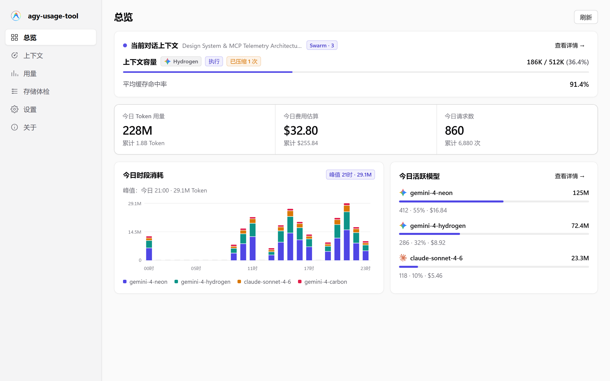
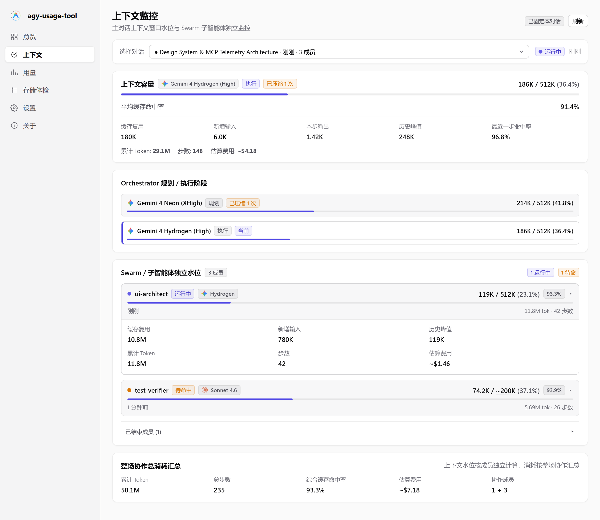
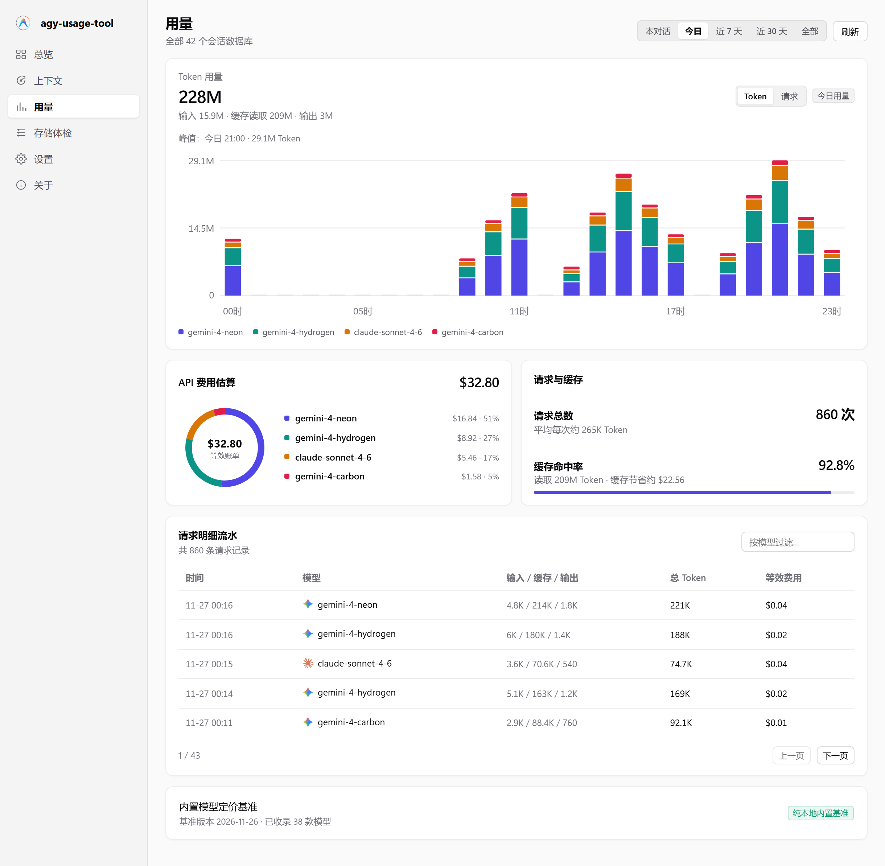

<div align="center">
  
  <h1>agy-usage-tool</h1>
  <p><strong>A local usage dashboard for Antigravity</strong></p>
  <p>See what used the most tokens, how much context is left, and where your disk space went.</p>
  
  <p>
    <a href="#quick-install"><strong>Quick install</strong></a> ·
    <a href="https://github.com/laishaojue-commits/agy-usage-tool/releases">Releases</a> ·
    <a href="#screenshots">Screenshots</a> ·
    <a href="./README.md">简体中文</a>
  </p>
</div>

## Screenshots

<a href="./assets/screenshots/overview.png"></a>

<table>
  <tr>
    <th width="50%">How much context is left?</th>
    <th width="50%">Where did the tokens go?</th>
  </tr>
  <tr>
    <td width="50%" valign="top">
      <a href="./assets/screenshots/context.png"></a>
      <p>See context usage and compaction for the main conversation and its subagents.</p>
    </td>
    <td width="50%" valign="top">
      <a href="./assets/screenshots/usage.png"></a>
      <p>Break down tokens, requests, cache hits, and estimated costs by time and model.</p>
    </td>
  </tr>
</table>

## Quick install

**You need Antigravity and Node.js ≥ 22.15.0.** Check that `node -v` works in your terminal. Node.js is required for both the ZIP and source installs.

1. Download `agy-usage-v0.0.0.zip` from [Releases](https://github.com/laishaojue-commits/agy-usage-tool/releases). If the ZIP is not listed yet, use the source steps below.
2. Extract it into the plugin directory below. `plugin.json` should be directly inside that directory.

   | System | Plugin directory |
   | --- | --- |
   | Windows | `%USERPROFILE%\.gemini\config\plugins\agy-usage\` |
   | macOS / Linux | `~/.gemini/config/plugins/agy-usage/` |

3. Enable **agy-usage** in Antigravity's plugin manager, then open it from the left sidebar or add it using the auxiliary pane's **+** menu.

<details>
<summary><strong>Install from source</strong></summary>

```sh
git clone https://github.com/laishaojue-commits/agy-usage-tool.git
cd agy-usage-tool
npm ci --ignore-scripts
npm run plugin:install
```

Enable the plugin as above. Run only one install at a time if the installs share a staging directory.

</details>

<details>
<summary><strong>Upgrade from a ZIP or resolve a Windows directory lock</strong></summary>

1. Disable the plugin and move the entire old `plugins/agy-usage` directory outside the plugins folder as a backup.
2. Extract the new ZIP into a fresh `plugins/agy-usage` directory, then re-enable it. Extracting over an old install leaves obsolete files behind.
3. If Windows still reports a directory lock, fully quit Antigravity before replacing the directory.

UI preferences live in the separate plugin data directory. You don't need to move them with the program files.

</details>

## What else you can see

- **Request history:** Switch between today, 7 days, 30 days, or all time, and search individual requests.
- **Subagent usage:** See planning and execution separately, with context per member and usage totals for the whole collaboration.
- **Storage:** See how much space cache and logs use, without deleting anything.

> Statistics stay on your machine. The plugin does not read account credentials or send usage data. Dollar amounts are estimates, not actual charges. See [SECURITY.md](./SECURITY.md) for details.

## Development & license

<details>
<summary><strong>Build, test, and package</strong></summary>

```sh
npm ci --ignore-scripts
npm --prefix ui ci --ignore-scripts
npm --prefix plugin ci --omit=dev --ignore-scripts
npm test
npm run plugin:zip -- --rebuild
npm run check:privacy -- --include-build
```

The ZIP and checksum file are written to `artifacts/`.

</details>

[MIT License](./LICENSE) (Copyright © 2026 Enzoo404). Built on [Enzoo404/gravitybox](https://github.com/Enzoo404/gravitybox) (`v1.1.3`) for its local usage, context, and pricing modules. See [THIRD_PARTY_NOTICES.md](./THIRD_PARTY_NOTICES.md).
